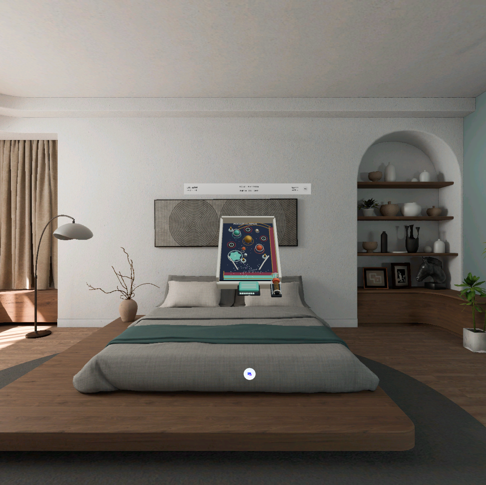

# Pocket Cosmos | 口袋宇宙弹球

[中文说明](README.zh-CN.md) · [Download release APK](https://github.com/kejing-dev/pocket-cosmos/releases/latest)

A compact, gesture-controlled spatial game for PICO shared space.



## Play

- Pull the spring-loaded rocket piston to launch into a miniature cosmos.
- Stars, moving moons, gravitational slingshots, comets, wormholes and nebulae influence the route and scoring.
- Hold one physical pedal for a continuous, non-solid gravity field. Start with 10 cells and consume 1 cell/second.
- Energy is spent first. When empty, 50 points buy one cell; releasing recharges one cell every four seconds. No score overdraft.
- Three beacons unlock an eight-second Nova multiplier. A bottom return route brings a lost ball back to the launcher.
- The single top HUD includes previous/current events, score, energy and mute.

## Build

Use JDK 21, Android SDK platform 35 and the checked-in Gradle wrapper. The project uses PICO Spatial SDK / SpatialUI **6.1.9**, Kotlin and Noto Sans SC. Do not upgrade the SDK implicitly.

```sh
./gradlew testDebugUnitTest assembleDebug
./gradlew assembleRelease
```

On Windows use `gradlew.bat`. Set `ANDROID_HOME` or create an untracked `local.properties` containing `sdk.dir`. Dependencies are fetched from Google, Maven Central and the PICO artifact repository declared in `settings.gradle.kts`.

For a signed release set `ARCADE_KEYSTORE_PATH`, `ARCADE_KEYSTORE_PASSWORD`, `ARCADE_KEY_ALIAS` and `ARCADE_KEY_PASSWORD` in your local environment. Without them Gradle emits an unsigned release APK. Keys and passwords are never part of this repository or its releases.

The published APK is a non-debuggable release build with a dedicated release signing key. Its certificate differs from earlier development APKs. Android cannot overwrite those debug-signed installs with this package; back up any needed data before replacing a development install.

## Project layout

`app/src/main` contains the Kotlin app and this game's runtime assets; `models` contains its editable Blender source. The deterministic simulation library and regression suite are shared with the original four-game prototype, so unused game branches remain in source. This standalone project only builds the named app and does not bundle the other games' models or music library media.

## Verification and limits

See [validation](docs/VALIDATION.md) for build, test, APK and signing evidence. Screenshots show native PICO runtime captures from this standalone debug build with v0.11 gameplay. Its fixed-camera HUD regression passed 320 updates. These captures do not prove physical hand input. Real hand tracking, subjective sound, binocular comfort and sustained device performance still require device testing.

## Assets and third-party dependencies

Original game models are included as GLB/Blender files. Noto Sans SC is covered by the [SIL Open Font License](licenses/NotoSansSC-OFL.txt). PICO Spatial SDK and Android dependencies retain their respective licenses. No signing keys, device identifiers or private conversation transcripts are included.

[Retained regression score attribution / 回归数据曲谱来源](licenses/music-scores.md)
